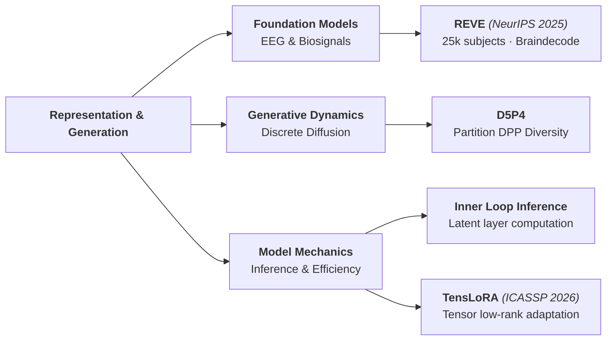

<picture>
  <source media="(prefers-color-scheme: dark)" srcset="assets/dark.jpeg">
  <source media="(prefers-color-scheme: light)" srcset="assets/light.jpeg">
  
</picture>

# Jonathan Lys
<h1 align="center">Jonathan Lys</h1>

> I study how masked models learn representations and generate diverse outputs.

  <b>PhD Candidate in Machine Learning · IMT Atlantique (<a href="http://recherche.imt-atlantique.fr/brain/">BRAIN Team</a>)</b> 
  <i>Investigating discrete diffusion, diversity-aware decoding, and foundation models for biosignals.</i>

Third-year PhD candidate at **[IMT Atlantique](https://www.imt-atlantique.fr/en)** in the **[BRAIN team](http://recherche.imt-atlantique.fr/brain/)** (Brest, France). My work focuses on discrete diffusion, diversity-aware decoding, and EEG foundation models.

  
  
  
  
  
  

Previously Visiting Scientist at **Sony Europe** and Research Intern at **Criteo AI Lab**.
---

[Website](https://jonathanlys01.github.io) &nbsp;·&nbsp;
[Google Scholar](https://scholar.google.com/citations?user=heUq7WEAAAAJ) &nbsp;·&nbsp;
[Hugging Face](https://huggingface.co/jonathan-lys) &nbsp;·&nbsp;
[ORCID](https://orcid.org/0009-0006-7908-843X) &nbsp;·&nbsp;
[LinkedIn](https://www.linkedin.com/in/jonathan-lys/) &nbsp;·&nbsp;
[Email](mailto:jonathan.lys@imt-atlantique.org)
### 🔬 Research Map

---

### Selected Work
### 🌟 Selected Work & Contributions

* **REVE: A Foundation Model for EEG — Adapting to Any Setup with Large-Scale Pretraining on 25,000 Subjects**  
  *NeurIPS 2025*  
  Pretrained foundation model adapting to arbitrary electrode layouts across clinical and cognitive domains.  
  [[Paper]](https://arxiv.org/abs/2510.21585) &nbsp;·&nbsp; [[Project Page]](https://brain-bzh.github.io/reve/) &nbsp;·&nbsp; [[Models & Data]](https://huggingface.co/collections/brain-bzh/reve) &nbsp;·&nbsp; [[Braindecode]](https://braindecode.org/stable/generated/braindecode.models.REVE.html) &nbsp;·&nbsp; [[Embedding Atlas]](https://jonathanlys01.github.io/projects/reve-atlas/)
<table>
  <tr>
    <td width="50%" valign="top">
      <h3>🧠 <a href="https://brain-bzh.github.io/reve/">REVE</a></h3>
      
<b>NeurIPS 2025</b> · <i>A Foundation Model for EEG</i>

      
Adapting to any recording setup with large-scale pretraining across 25,000 subjects and clinical/cognitive tasks.

      

        
        
        
      

    </td>
    <td width="50%" valign="top">
      <h3>🎲 <a href="https://arxiv.org/abs/2603.19146">D5P4</a></h3>
      
<b>Preprint 2026</b> · <i>Discrete Diffusion Decoding</i>

      
Partition Determinantal Point Process (DPP) to balance quality and diversity in parallel discrete diffusion generation.

      

        
      

    </td>
  </tr>
  <tr>
    <td width="50%" valign="top">
      <h3>🔄 <a href="https://arxiv.org/abs/2602.14759">Inner Loop Inference</a></h3>
      
<b>EUSIPCO 2026</b> · <i>Transformer Capabilities</i>

      
Extending computation depth in frozen Transformers by revisiting internal layers during inference without retraining.

      

        
      

    </td>
    <td width="50%" valign="top">
      <h3>⚡ <a href="https://arxiv.org/abs/2509.19391">TensLoRA</a></h3>
      
<b>ICASSP 2026</b> · <i>Efficient Adaptation</i>

      
Tensor alternatives for low-rank adaptation, unlocking flexible parameter-efficient fine-tuning.

      

        
      

    </td>
  </tr>
</table>

* **D5P4: Partition Determinantal Point Process for Diversity in Parallel Discrete Diffusion Decoding**  
  *arXiv 2026*  
  Balancing quality and generation diversity in parallel discrete diffusion models.  
  [[Paper]](https://arxiv.org/abs/2603.19146)
---

* **Inner Loop Inference for Pretrained Transformers: Unlocking Latent Capabilities Without Training**  
  *EUSIPCO 2026*  
  Extending computation depth in frozen Transformers by revisiting internal layers during inference.  
  [[Paper]](https://arxiv.org/abs/2602.14759)
### 🛠️ Toolkit & Technologies

* **TensLoRA: Tensor Alternatives for Low-Rank Adaptation**  
  *ICASSP 2026*  
  Tensor decompositions for parameter-efficient adaptation of large models.  
  [[Paper]](https://arxiv.org/abs/2509.19391)

  
  
  
  
  
  
  
  

---

### Background
### 🎓 Background & Experience

* **2024 – Present** — PhD Candidate in Machine Learning, IMT Atlantique *(BRAIN team)*
* **2024** — Visiting Scientist, Sony Europe *(Brest, France)*
* **2023 – 2024** — M.Sc. in Signal, Vision, Waves, Systems (SiVOS), Université de Rennes 1
* **2023** — Research Intern, Criteo AI Lab *(Paris, France)*
* **2023** — Academic Exchange, University of Technology Sydney (UTS)
* **2021 – 2024** — Diplôme d'Ingénieur (M.Sc. in Engineering), IMT Atlantique
* **2024 – Present** — **PhD Candidate in Machine Learning**, IMT Atlantique *(BRAIN Team, Brest)*
* **2024** — **Visiting Scientist**, Sony Europe *(Brest, France)*
* **2023 – 2024** — **M.Sc. SiVOS** *(Signal, Vision, Waves, Systems)*, Université de Rennes 1
* **2023** — **Research Intern**, Criteo AI Lab *(Paris, France)*
* **2023** — **Academic Exchange**, University of Technology Sydney (UTS)
* **2021 – 2024** — **Diplôme d'Ingénieur**, IMT Atlantique
